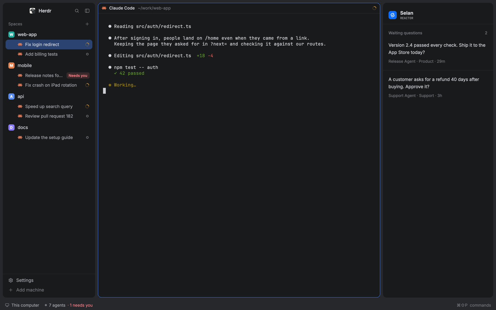

# Selan for Herdr

A [Herdr](https://herdr.dev) layout for working with many coding agents and
[Selan Reactor](https://selan.ai): each space lists its agents under it in the sidebar, and the questions your
Reactor agents are waiting on sit in a panel on the right that shows only while one waits. It looks like
JetBrains' Islands Dark: rounded islands on a grey frame, Inter for the interface.



## Install

Ask the agent in your Herdr window:

> add herdr.dev/layouts/selan-ai/herdr-selan

or, from a clone of this repo:

```sh
./install.sh
```

It copies the layout and its four mods into `~/.config/herdr-app` (or `$HERDR_APP_HOME`), checks each mod and
switches to the layout. Herdr must be running. The Reactor panel needs the Selan CLI, signed in:

```sh
selan login
selan reactor questions   # should list your waiting questions
```

`ctrl-shift-l` switches back to your previous layout.

## Save changes

```sh
./save.sh
```

It copies the files listed in `files.txt` back from Herdr into this repo, and nothing else: never Herdr's state
(`view.json`, `shared.json`, `data/`, `window.json`, `layouts/.state/`), which holds your spaces, history and
window.

## What's in it

`RECIPE.md` describes the layout in full. The `selan-spaces`, `selan-chrome` and `selan-status` mods are changed
copies of Herdr's own (Apache-2.0, `LICENSE`); `selan-reactor` is a copy of
[selan-ai/herdr-reactor](https://github.com/selan-ai/herdr-reactor) (MIT, its `LICENSE`). Inter is under the SIL
Open Font License (`mods/selan-chrome/fonts/LICENSE-Inter.txt`).
