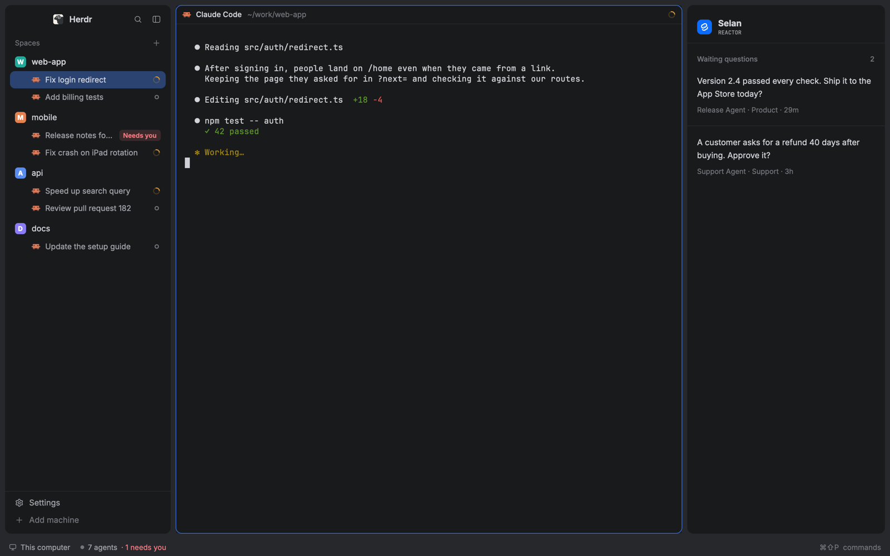

# Selan

A Herdr layout for working with many coding agents and Selan Reactor: each space lists its agents under it in
the sidebar, in place of a tab bar, and the questions your Reactor agents are waiting on sit in a panel on the
right that shows only while one waits. The look is JetBrains' Islands Dark (WebStorm, IntelliJ): the
sidebar, the terminals and the Reactor panel are rounded islands on a grey frame, with Inter for the interface.

## What you see

- **The frame**, `canvas` `#26282c`, with the window's own title bar hidden (`titlebar: none`). Three islands sit
  on it 8 px from every edge and 8 px apart, with a 28 px status bar under them on the frame.
- **The sidebar island**, 268 px, `chrome` `#191a1c`, 10 px corners. Top to bottom:
  - A 46 px row: the macOS window buttons at (20, 24), then Herdr's mark and name, search and the sidebar toggle.
    Its top corners are rounded with the island.
  - "Spaces" at 11.5 px `dim` with a + for a new space, then the spaces. Each space is a 30 px row: a colored
    18 px avatar with the space's first letter, its name, then only what is unusual about its repo, in `dim`:
    a branch other than main that the name doesn't already say, and ahead/behind. Never the repo's name. The
    space's name keeps its width and the branch truncates first. Under it, one 28 px row per tab: the agent's icon at 14 px, aligned under
    the space's name, the agent's live title at 12.5 px, and its status at the right. The shown tab is
    `selected` `#2a4371`. A tab's sub-agents follow it, indented 22 px per level, at 12 px. 4 px under each
    space's group. With another machine added, the spaces are grouped under a 30 px header per machine: its
    mark (a monitor for this computer, a server for the others) at 14 px and its name at 12 px semibold, both
    in `foreground`, the rest of the row `muted`; 10 px above every header but the first.
  - A footer with Settings and Add machine, a `border` line above it, bottom corners rounded.
- **The terminal island**: the shown tab's panes as cards, 10 px corners, a 30 px header (icon, program, folder),
  `background` `#191a1c`. The focused pane has a 1 px `accent` `#3871e1` border.
- **The Reactor island**, 320 px, the same island look: the Selan mark, "Selan" over "REACTOR", then
  "Waiting questions" and the questions newest first, each with `agent · workspace · age` under it. While none
  wait it is hidden and the terminal island takes its place.
- **The status bar**, on the frame's color with no line: the machine, the branch, how many agents and how many
  need you, then at the right Reactor's mark and "Reactor", "N running" after a `working` spinner while runs go,
  "N errors" in `blocked` and "N warnings" in muted after a small `working` dot for the runs of the last 24 h
  that went wrong or ended with a warning (each part only when there is some, a dim "·" between them), and the
  command palette's key.
- **Colors**: Islands Dark from JetBrains' own theme and editor scheme. Terminal text `#bcbec4`, selection
  `#214283`, cursor `#ced0d6`; interface text `#d1d3d9`, muted `#9fa2a8`, dim `#73767c`; borders `#393b40`,
  which also edge every overlay; hover `#35373c`, raised `#393b40`; status colors working `#d59637`, blocked
  `#f57e84`, done `#6db083`, idle `#73767c`. ANSI colors are the scheme's console colors.
- **Type**: Inter (shipped in `mods/selan-chrome/fonts/`) for the interface, JetBrains Mono in terminals.

## How it behaves

- **Agent status** on each tab row: working is a spinning ring in `working`; blocked is a "Needs you" pill in
  `blocked` on a 15% tint; done is a `done` dot; idle is a ring in `idle`. The tab's status is its most urgent
  agent's.
- **Pressing a tab row** shows that space and tab. Double-press renames the tab; right-press opens its menu
  (Rename, New tab, Close). Sub-agent rows focus the agent's pane, or peek at it when it has none.
- **Hovering a space row** shows a + and a chevron. The + opens the new menu for that space: Terminal, then
  under "Start with Selan" Claude Code (`seland`) and Codex (`seland codex`), both with permission checks off
  and keys 1 and 2, then New space and the worktree items. An agent that isn't installed shows "not installed".
  The chevron folds the space to its one row. Folded, the row shows how many tabs it has and their most urgent
  status unless all are idle, and stays selected when it is the shown space. Folds are kept across restarts.
- **Pressing a space row** shows it; dragging it reorders spaces, with an accent line where it lands.
  A space from this computer, or one chat (tab row) of it, carried over another machine's header or its
  spaces, moves there when let go: while carried the pointer is a closed hand and the carried row is dimmed,
  and over such a machine its header is filled with `selected`. Letting go opens the `selan-teleport` dialog
  ([herdr-teleport](https://github.com/selan-ai/herdr-teleport)) with `{ space, tab?, machine }`, 440 by 190.
  Only when that mod is installed (its `main.js` is in Herdr's folder, `appHome()`, looked for with the
  machines every 15 s), and only on a machine that is connected and reached over ssh. A chat is never
  reordered: let go anywhere else, its press is a click.
- **The Reactor panel** reads the questions every 60 s through the Selan CLI, puts their count on the Dock
  badge and raises a toast for each new one. Pressing a question opens a dialog to answer it. With no question
  waiting its island is hidden; a new question or a failed read shows it again.
- **The Reactor counts** in the status bar are read every 60 s through the Selan CLI (`selan reactor runs
  --json`). Pressing a count opens a popup just above the bar listing those runs, newest first and at most 10:
  the agent, `state · age`, and for an error or a warning the agent's own line. Pressing a row opens that run's
  page in Reactor in the browser and closes the popup. One popup at a time: pressing the same count again, Esc
  or a click outside closes it, and another count replaces it. A failed read leaves "Reactor" dim, with why on
  hover.
- A narrow sidebar (under 160 px, the toggle's rail) shows spaces as numbers with a status dot.

## Built from

- `layouts/selan.json`: a `column` root (`theme: graphite` with the Islands Dark `colors`, `ui_font: Inter`,
  `traffic_lights: [20, 24]`) holding a `body` row (padding 8, gap 8) and the `status` block. The row holds
  the `sidebar` column (`brand` block, `spaces` block, `sidebar-footer` block), the `work` column (the `main`
  tab block and the shipped hidden Files/Changes `panel`), and the `reactor` block (padding `[10, 0]` so the
  mod's square edges sit inside the island's corners).
- `mods/selan-spaces`: a changed copy of Herdr's `spaces` mod. It reads `spaces()`, `panes()` and `terminals()`
  once per render and draws each space's tabs and sub-agents under it.
- `mods/selan-chrome`: Herdr's `workspace-chrome` with its top row's top corners and its footer's bottom corners
  rounded to 10 px, and Inter in `fonts/`.
- `mods/selan-status`: Herdr's `workspace-status` on `canvas` with no top line, plus the Reactor counts from
  `selan reactor runs --json` and their popup (the same mod, opened with props `{ list, runs }`; the open one is
  in shared `selan-status.popup`).
- `mods/selan-new-menu`: Herdr's `new-menu` with its agents fixed to Claude Code and Codex, started as
  `seland` and `seland codex --no-daemon` (Herdr's own Codex launch adds `--no-daemon`).
- `mods/selan-reactor`: a copy of [selan-ai/herdr-reactor](https://github.com/selan-ai/herdr-reactor)'s mod,
  given props `{ "hide": "reactor" }`. It runs the Selan CLI (`selan reactor questions --json`,
  `selan reactor answer`), which holds the sign-in; the mod never sees a token.
- The shipped `pane` (pane headers), `menu`, `files` and `changes` mods.

## Watch out

- Mods paint their own background over a layout node's rounded corners: the sidebar's rows round their own
  corners, and the Reactor block keeps its mod inside by vertical padding.
- The Reactor mod keeps reading while its block is hidden, which is what shows it again.
- The Reactor panel and the menu's agents need the Selan CLI on `PATH`, signed in (`selan login`); Codex also
  needs the Codex CLI (`brew install --cask codex`). The status bar's Reactor counts need selan 1.33 or later
  (`selan update`); an older one leaves "Reactor" dim and says so on hover. Rows that open their run in Reactor
  need selan 1.33.1 or later, and the warnings count a selan that lists warnings; an older one shows plain rows
  and no warnings.
- The four `selan-*` copies of shipped mods don't follow Herdr's updates to `spaces`, `workspace-chrome`,
  `workspace-status` and `new-menu`; `cloned_from` in each `mod.json` names the version they came from.

## Done when

- `herdr-app check` passes for each of the five mods and `layout.switch {"name":"selan"}` shows three islands.
- Each space lists its tabs with their agents' status, and pressing one shows it.
- With questions waiting the Reactor island lists them; with none it is hidden.
- The status bar shows Reactor's running, error and warning counts; pressing one lists those runs, and
  pressing a row opens its run in Reactor.
- A space's + offers Terminal, Claude Code and Codex, and each agent starts through `seland`.
